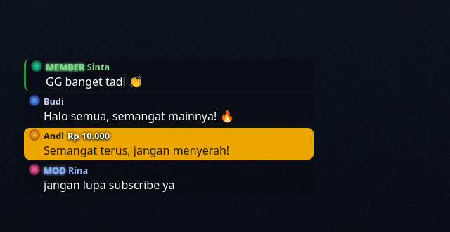
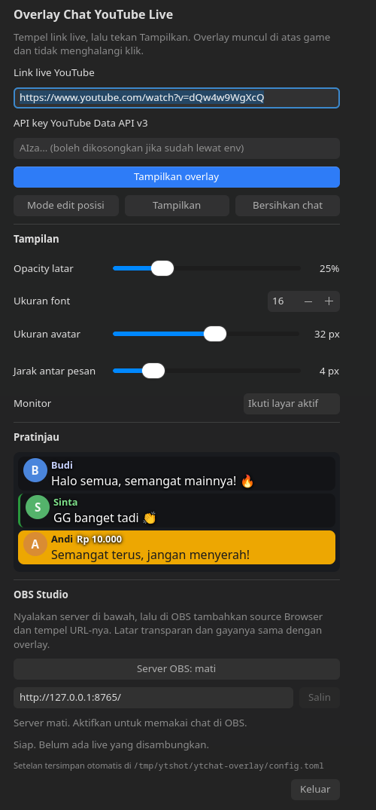

# ytstream-ingame-overlay

Overlay chat, webcam, dan statistik YouTube Live untuk **KDE Plasma 6 (Wayland)**:
jendela transparan yang selalu di atas game, **klik-tembus** (klik tetap tembus
ke game), dan posisinya bisa digeser dengan mouse saat mode edit.

Isi overlay: nama pengirim + badge (owner/mod/member), avatar, emoji (termasuk
emoji custom kanal), highlight Super Chat/Super Sticker + nominal, dan pesan
lama memudar otomatis. Ada juga **overlay webcam** dan kartu **statistik live**
(penonton, subscriber, total tayangan) di layar, terpisah dari OBS.



Panel pengaturannya:



Gambar di atas memakai contoh pesan, bukan live sungguhan.

## Kebutuhan

- KDE Plasma 6 dengan sesi **Wayland** (butuh protokol `wlr-layer-shell`).
- `gtk4-layer-shell` (skrip pasang menangani ini).
- `v4l-utils` untuk header `libv4l2` saat build (dipakai webcam; skrip pasang
  menangani ini juga).
- Pengguna harus bisa membaca `/dev/video*` — biasanya sudah lewat grup `video`.
- Rust/cargo untuk build.
- YouTube Data API v3 key (dari Google Cloud Console, aktifkan *YouTube Data API v3*).

## Pasang

```bash
./install.sh
```

Skrip itu: memasang `gtk4-layer-shell` dan `v4l-utils` bila belum ada (minta
password sudo), build release, memasang binary ke `~/.local/bin`, menambah entri menu
"YTStream In-Game Overlay" + ikon, lalu langsung menjalankan aplikasinya.

Opsi lain:

```bash
./install.sh --no-run      # pasang saja, tanpa menjalankan
./install.sh --no-deps     # lewati pemasangan dependensi sistem
./install.sh --uninstall   # hapus binary, entri menu, dan ikon
```

Setelah terpasang, aplikasi bisa dibuka dari menu aplikasi KDE kapan saja.
`--uninstall` menghentikan aplikasi yang sedang berjalan dan membiarkan file
config (`~/.config/ytstream-ingame-overlay/`) tetap ada.

## Pemakaian panel

1. Buka **YTStream In-Game Overlay** dari menu.
2. Tempel **link live** (bentuk `https://www.youtube.com/watch?v=…`,
   `https://youtu.be/…`, atau `https://www.youtube.com/live/…`) — atau cukup ID videonya.
3. Isi **API key** (tersimpan di config; cukup sekali).
4. Tekan **Tampilkan overlay**. Chat akan muncul di pojok kiri atas layar.

Tombol di panel:

| Tombol | Fungsi |
|---|---|
| **Tampilkan overlay** | Menyambung ke live tersebut dan menampilkan overlay. Ganti link lalu tekan lagi untuk pindah live. |
| **Mode edit posisi** | Mengaktifkan input pada overlay: geser dengan mouse, lalu matikan lagi untuk menyimpan posisi. |
| **Sembunyikan / Tampilkan** | Menyembunyikan overlay tanpa memutus chat. |
| **Bersihkan chat** | Menghapus semua pesan yang sedang tampil. |
| **Server OBS** | Menyalakan/mematikan server lokal untuk Browser Source OBS (lihat bagian di bawah). |
| **Webcam / Statistik** | Menyalakan jendela webcam atau kartu statistik live di layar (lihat bagiannya masing-masing). |
| **Keluar** | Menutup aplikasi (overlay ikut hilang). |

Menutup jendela panel juga menghentikan overlay, supaya tidak ada overlay
"hantu" yang tidak bisa dikendalikan lagi.

### Bagian Tampilan

| Kontrol | Arti |
|---|---|
| **Opacity latar** | Kegelapan kotak di belakang tiap pesan (0% = tanpa latar, 100% = hitam pekat). Berlaku langsung ke pesan yang sudah tampil. |
| **Ukuran font** | Ukuran teks chat dalam piksel (10–48). |
| **Ukuran avatar** | Ukuran foto profil bulat di samping pesan (12–48 px). Berlaku langsung ke pesan yang sudah tampil. |
| **Jarak antar pesan** | Spasi vertikal antar kotak pesan (0–20 px). 0 = pesan menempel rapat, 6–10 = lebih lega. |
| **Monitor** | Layar tempat overlay tampil. "Ikuti layar aktif" = layar yang sedang dipakai. Pindah monitor tidak menghapus chat yang sudah tampil. |

Di bawah setelan Tampilan ada kotak **Pratinjau** berisi tiga contoh pesan (biasa,
member, Super Chat) dengan latar gelap. Ukuran font, opacity latar, ukuran avatar,
dan jarak antar pesan di pratinjau sama persis dengan overlay sungguhan, jadi
gampang mengatur sebelum live dimulai. Pratinjau ikut berubah begitu slider
digeser.

Jendela panel bisa diperbesar/diperkecil dan isinya bisa di-scroll, jadi tetap
terpakai di layar kecil (mis. laptop 1366×768). Ukuran bawaannya 470×820.

Semua setelan di panel tersimpan otomatis ke file config.

## Tampil di OBS Studio

Overlay ini adalah jendela layer-shell, jadi OBS tidak bisa menangkapnya lewat
Window Capture (yang tertangkap hanya jendela panel). Untuk OBS, aplikasi
menyediakan halaman web lokal yang dipakai sebagai **Browser Source**:

1. Di panel, gulir ke bagian **OBS Studio**, tekan tombol **Server OBS: mati**
   sampai berubah jadi **Server OBS: aktif**. Port bawaannya `8765`.
2. Salin URL yang muncul (`http://127.0.0.1:8765/`) dengan tombol **Salin**.
3. Di OBS: **Sources → + → Browser**, tempel URL tadi.
4. Atur lebar/tinggi source sesuai keinginan (mis. 420×500). Latarnya transparan,
   jadi tidak perlu chroma key.
5. Jangan centang *Shutdown source when not visible* kalau ingin chat tetap
   tersambung saat source disembunyikan.

Isi chat, warna Super Chat, badge member, emoji, avatar, ukuran font, opacity,
jarak antar pesan, dan fade memakai setelan yang sama dengan overlay di layar.
Menggeser slider di panel juga langsung mengubah halaman OBS tanpa perlu reload,
dan tombol **Bersihkan chat** mengosongkan keduanya sekaligus.

Server hanya mendengarkan di `127.0.0.1` (tidak bisa diakses dari jaringan lain),
mati secara bawaan, dan ikut berhenti saat aplikasi ditutup. Bila port `8765`
sudah dipakai program lain, panel menampilkan pesan gagal — matikan program itu
atau pakai satu instance aplikasi saja.

## Webcam di layar

Kamera bisa tampil di atas game tanpa lewat OBS. Gambarnya berupa jendela
transparan bertepi bulat yang selalu di atas dan **klik-tembus**, syaratnya
sama dengan overlay chat.

1. Di panel, gulir ke bagian **Webcam di layar**, pilih **Perangkat**
   (biasanya `/dev/video0`).
2. Tekan tombol **Webcam: mati** sampai berubah jadi **Webcam: aktif**.
3. Atur **Ukuran** (lebar gambar di layar) dan **Rasio** — `4:3`, `16:9`, atau
   `1:1`. Gambar dipotong mengikuti rasio (bukan diregangkan), jadi tidak ada
   wajah yang lonjong.
4. Centang **Cermin** kalau ingin gambarnya dibalik seperti cermin.
5. Untuk memindahkan: aktifkan **Mode edit posisi**, geser jendela webcam (dan
   chat) dengan mouse, lalu matikan lagi untuk menyimpan posisinya.

Status di bawah tombol menunjukkan hasilnya, mis. `Kamera aktif: video0 640×480
MJPG.` Kalau kamera dicabut atau sedang dipakai aplikasi lain, aplikasi mencoba
menyambung lagi tiap beberapa detik dan menampilkan pesan gagalnya.

Webcam hanya untuk layar: halaman Browser Source OBS tetap berisi chat saja.
Kalau ingin webcam ikut ke OBS, tambahkan source **Video Capture Device**
biasa di OBS.

## Statistik live

Kartu kecil berisi tiga angka selama live berlangsung:

| Baris | Isinya |
|---|---|
| **Penonton** | Jumlah orang yang sedang menonton saat ini (`concurrentViewers`). |
| **Subscriber** | Jumlah subscriber kanal pemilik live. Disembunyikan kanal? Tampil `–`. |
| **Total view** | Total tayangan video live itu sampai sekarang. |

Nyalakan lewat tombol **Statistik: mati** di bagian **Statistik live** pada panel,
lalu atur **Ukuran font**. Kartunya klik-tembus dan posisinya digeser lewat
**Mode edit posisi**, sama seperti chat dan webcam.

Angka diperbarui tiap ±30 detik (bukan tiap detik) supaya kuota API tetap aman:
sekali pembaruan memakai 2 unit (satu untuk video, satu untuk kanal). Selama live
belum tersambung, kartunya menampilkan `–`.

Kartu ini hanya tampil di layar; halaman Browser Source OBS tetap berisi chat
saja. Kalau ingin angka penonton ikut di OBS, pakai widget bawaan OBS atau
browser source terpisah.

## File config

`~/.config/ytstream-ingame-overlay/config.toml` (dibuat otomatis saat pertama jalan).
Bisa diedit manual; perubahan dari file berlaku setelah aplikasi dijalankan ulang.

Kalau sebelumnya memakai versi bernama `ytchat-overlay`, config lama di
`~/.config/ytchat-overlay/config.toml` disalin otomatis ke folder baru saat
pertama dijalankan — link live dan API key tidak hilang.

| Kunci | Default | Arti |
|---|---|---|
| `api_key` | `""` | YouTube Data API v3 key. Bisa juga lewat env `YOUTUBE_API_KEY`. |
| `video` | `""` | Link/ID live terakhir (diisi otomatis dari panel). |
| `output` | `""` | Nama konektor monitor, mis. `HDMI-A-1` / `DP-1`. Kosong = layar aktif. |
| `layer` | `"overlay"` | Lapisan layer-shell: `overlay` (paling atas) atau `top`. |
| `x`, `y` | `30`, `200` | Posisi kotak chat (piksel dari pojok kiri atas monitor). |
| `width`, `height` | `420`, `500` | Ukuran kotak chat. |
| `font_family` | `"Noto Sans"` | Font chat. |
| `font_size` | `16.0` | Ukuran font (piksel). |
| `text_color` | `"#ffffff"` | Warna teks chat. |
| `bg_opacity` | `0.25` | Kegelapan latar pesan (0.0–1.0). |
| `show_avatars` | `true` | Tampilkan avatar pengirim (bulat, seperti live chat YouTube). |
| `avatar_px` | `16` | Ukuran avatar dalam piksel (12–48). Bisa diatur lewat slider "Ukuran avatar" di panel. |
| `msg_gap` | `4` | Jarak vertikal antar kotak pesan dalam piksel (0–20). Slider "Jarak antar pesan" di panel. |

> **Migrasi dari versi awal:** kunci lama `avatar_size` (dulu 28) sudah tidak
dipakai dan diabaikan saat membaca config. Ukuran avatar sekarang memakai
`avatar_px` dengan bawaan 16 px, jadi tidak perlu menghapus config lama —
nilainya akan tertulis sendiri sebagai `avatar_px` begitu kamu menggeser slider.
| `max_messages` | `40` | Jumlah pesan maksimum yang ditahan di layar. |
| `fade_after_secs` | `30.0` | Pesan mulai memudar setelah N detik. `0` = tidak pernah memudar. |
| `fade_duration_secs` | `3.0` | Lama proses memudar sampai hilang. |
| `poll_min_ms` | `5000` | Interval polling minimum ke API (ms). Lebih besar = lebih hemat kuota. |
| `cam` | `false` | Tampilkan webcam di layar saat aplikasi dibuka. |
| `cam_device` | `"/dev/video0"` | Perangkat V4L2 kamera. |
| `cam_width` | `280` | Lebar gambar webcam di layar (piksel). Tinggi mengikuti rasio kamera. |
| `cam_x`, `cam_y` | `30`, `720` | Posisi jendela webcam (piksel dari pojok kiri atas monitor). |
| `cam_mirror` | `true` | Balik gambar seperti cermin. |
| `cam_ratio` | `"4:3"` | Rasio gambar webcam: `"4:3"`, `"16:9"`, atau `"1:1"`. |
| `stats` | `false` | Tampilkan kartu statistik live. |
| `stats_x`, `stats_y` | `470`, `200` | Posisi kartu statistik (piksel dari pojok kiri atas monitor). |
| `stats_font_size` | `16.0` | Ukuran teks kartu statistik (10–40 px). |

## Pemakaian lewat terminal (opsional)

```bash
ytstream-ingame-overlay "https://youtu.be/VIDEO_ID"   # langsung jalankan overlay + panel
ytstream-ingame-overlay ctl toggle                    # sembunyikan/tampilkan overlay
ytstream-ingame-overlay ctl edit                      # masuk/keluar mode edit posisi
ytstream-ingame-overlay ctl lock                      # keluar mode edit & simpan posisi
ytstream-ingame-overlay ctl clear                     # hapus semua pesan
ytstream-ingame-overlay ctl quit                      # keluar dari aplikasi
```

## Catatan

- Kuota API gratis 10.000 unit/hari; polling tiap 5 detik biasanya cukup untuk
  beberapa jam pemakaian. Statistik live menambah 2 unit tiap ±30 detik.
- Emoji custom diambil sekali dari halaman live chat. Kalau peta emoji tidak
  tersedia, emoji custom tampil sebagai teks `:nama:`.
- Kalau ikon belum muncul di menu setelah install: jalankan `kbuildsycoca6`
  atau logout/login sekali.
- Uninstall: `./install.sh --uninstall` (config dan setelan tidak dihapus).
